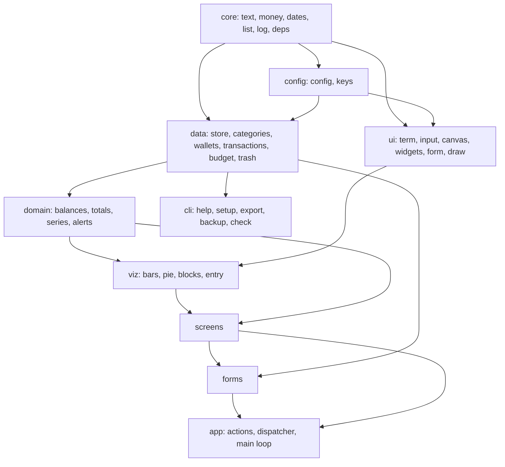

# Architecture

kreuzer is a set of small bash modules loaded by `lib/kreuzer/main.sh`. `bin/kreuzer` only finds the library directory and calls `main`.

## Layers

A module may only use modules in layers above it in this diagram. That rule prevents circular dependencies, and it keeps `data/` free of terminal code, so export, backup and tests need no terminal.

Load order is the `KREUZER_MODULES` array in `main.sh`. Function bodies are resolved at call time, so only top-level declarations (arrays, constants) depend on it.

## Conventions

- **Names.** Functions are `module_verb` with plain underscores, for example `money_format` or `store_atomic`. Screen hooks are `screen_<name>_<hook>`. Forms end in `_form`. Constants and globals are uppercase.
- **Out-variables.** Functions return values through documented globals (`M` for formatted money, `PM` for parsed cents, `PAD`, `TRIM`, `NID`, `BUD`, ...) instead of `$(...)`. The draw loop makes hundreds of calls per frame, and command substitution forks each time. Each file header lists the globals it sets.
- **Money** is integer cents everywhere. Display and parsing are in `core/money.sh` only.
- **Empty fields** in data files are written as `-`. `read` with a tab separator collapses empty fields and would shift every later column.
- **Declarations** at top level use `declare -gA` for associative arrays, so they stay global even if a file is sourced from inside a function (tests do this).
- **Headers.** Every file starts with a purpose line and lists `Depends on`, `Provides`, and the globals it uses.

## Rendering

`draw` builds the whole frame in a buffer and writes it once. It only renders cached data. `refresh` reloads data and then draws, so moving the cursor never starts `awk`.

`refresh` bumps `DVER`. Every chart cache key includes it, so a reload invalidates all caches without any bookkeeping. Call `refresh` after any write and the charts are current.

Popups (help, picker, alerts) set `OVERLAY` to a function name that `draw` calls last, so they are repainted over the screen after every key or resize.

## Screens

A screen `NAME` provides four functions:

| Function | Purpose |
|---|---|
| `screen_NAME_load` | fills `ROWS_DATA` (raw rows), `TX` (rows behind the charts) and `SELECTABLE` |
| `screen_NAME_row` | formats one raw row into `RR` |
| `screen_NAME_title` | sets `TL` (heading) and `CH` (column header) |
| `screen_NAME_viz` | draws the chart pane inside `VX VY VW VH` |

`draw` and `refresh` find them by name. To add a screen:

1. Create `lib/kreuzer/screens/NAME.sh` with the four functions.
2. Add the name to `SCREENS` and a label to `SCR_LABEL` in `ui/state.sh`.
3. Add the file to `KREUZER_MODULES` in `main.sh`.
4. Add a `goto_NAME` action to `ACTIONS`, `KEYDEF` and `ADESC` in `config/keys.sh`.
5. If it needs footer hints, add a case in `draw_footer` (`ui/draw.sh`).

Known limit: item actions (`action_add`, `action_edit`, `action_delete`, `action_move`, `action_sort`) still branch on `SCREEN` with a `case`. Screens with new item behaviour need a branch there.

## Forms

A form is declared with `form_begin` and one `form_field` per row, then run with `form_run`. Field types are `text otext money omoney smoney somoney date time pick:FN opick:FN choice:A|B`. Forms contain validation, previews and calls to data writers (`tx_save`, `wallet_create`, ...). They do not write files themselves.

Entry forms feed the live charts through `ENT_*` globals set by their preview function: `ENT_MONTH`, `ENT_AMT` (pending change in cents), `ENT_CAT`, and for transfers `ENT_WAL` and `ENT_WAL2`. `viz/entry.sh` reads them.

## Data safety

- Every rewrite goes through `store_atomic`: write to a temp file in the same directory, then `mv`. A crash leaves the old or the new file.
- `store_init` holds an exclusive `flock` on `.lock` for the life of the process.
- Ids come from one counter (`meta/seq`) shared by all record types and are never reused, so restored items find their old references.
